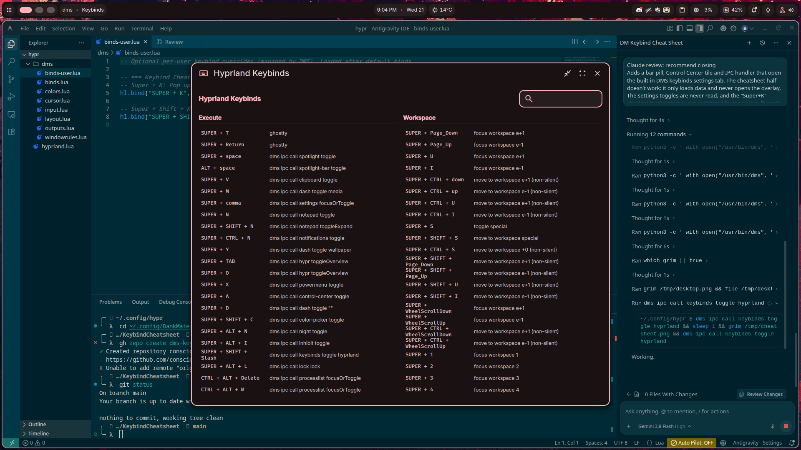

# Keybind Cheatsheet Plugin for DankMaterialShell (DMS)

A sleek, lightweight Quickshell plugin for **DankMaterialShell** that provides quick access to your compositor keybind settings and interactive cheatsheet overlay.



## Features

- 📊 **DankBar Widget**: Minimal, elegant pill showing a keyboard icon and customizable label.
  - **Left-Click**: Focuses or toggles the Keybind Settings window.
  - **Right-Click**: Launches the full-screen interactive Keybinds Cheatsheet overlay.
- 🎛️ **Control Center Tile**: Integrated tile and quick-action panel with direct buttons for settings and cheatsheet.
- 📡 **IPC Target**: Exposes `dms ipc call keybindCheatsheet cheatsheet` and `open`/`toggle`.
- ⚙️ **Configurable**: Easily enable/disable pill labels or customize right-click behavior via **DMS Settings → Plugins**.
- 🚀 **Zero Overhead**: Fully native QML / Quickshell implementation, compositor-agnostic.

---

## Installation

### Method 1: Via DMS Plugin Registry (Recommended once published)
```bash
dms plugins install keybindCheatsheet
```

### Method 2: Manual Installation
Clone this repository directly into your DMS plugins directory:

```bash
mkdir -p ~/.config/DankMaterialShell/plugins
git clone https://github.com/consciousY/dms-keybind-cheatsheet.git ~/.config/DankMaterialShell/plugins/KeybindCheatsheet
```

Then scan and enable the plugin:
```bash
dms ipc call plugin-scan scan
dms ipc call plugins enable keybindCheatsheet
```

---

## Adding to DankBar

1. Open **DMS Settings** (<kbd>Super</kbd> + <kbd>,</kbd>).
2. Go to **Appearance → DankBar Layout**.
3. Add `keybindCheatsheet` to your desired section (e.g., right or center).

---

## Optional: Global Hotkey Binding

If you want a global keyboard shortcut (such as <kbd>Super</kbd> + <kbd>K</kbd>) to pop up the keybind settings or cheatsheet, you can optionally bind it in your compositor configuration:

### Hyprland (`~/.config/hypr/dms/binds-user.lua` or `hyprland.conf`)
```lua
-- Super + K: Pop up Keybind Settings window
hl.bind("SUPER + K", hl.dsp.exec_cmd("dms ipc call settings focusOrToggleWith keybinds"))

-- Super + Shift + K: Toggle Keybinds Cheatsheet overlay
hl.bind("SUPER + SHIFT + K", hl.dsp.exec_cmd("dms ipc call keybindCheatsheet cheatsheet"))
```

### Niri (`config.kdl`)
```kdl
binds {
    Mod+K { spawn "dms" "ipc" "call" "settings" "focusOrToggleWith" "keybinds"; }
    Mod+Shift+K { spawn "dms" "ipc" "call" "keybindCheatsheet" "cheatsheet"; }
}
```

---

## License

MIT License — see [LICENSE](LICENSE) for details.
